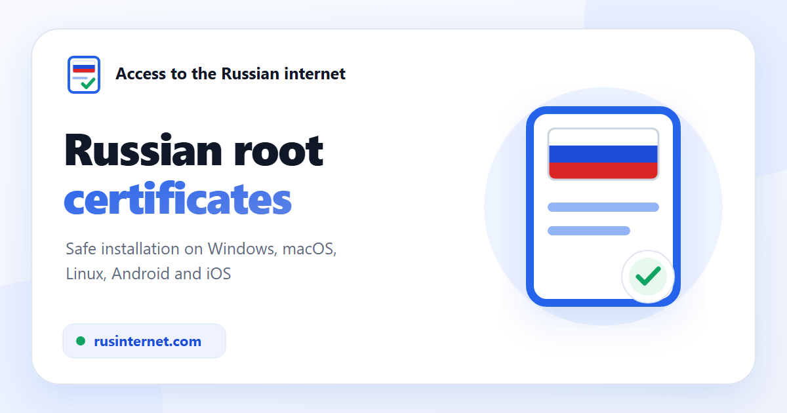

<p align="center">
  <a href="https://rusinternet.com/en/"></a>
</p>

<p align="center"><a href="README.md">Русский</a> · <b>English</b></p>

# Access to the Russian internet

**An open helper for the safe installation of the official Russian trusted certificates (the Russian Ministry of Digital Development's national certificate authority, NUC).**

**Site: [rusinternet.com](https://rusinternet.com/en/)** · RU / EN · Windows, macOS, Linux, iOS/iPadOS, Android

It helps when your browser shows a certificate error — "Your connection is not private", `ERR_CERT_AUTHORITY_INVALID`, "The certificate is not trusted" — on Gosuslugi, in online banks, on marketplaces, on social networks and on news sites.

---

## Why this is needed

Since 2022, foreign certificate authorities (GlobalSign, DigiCert, Sectigo and others) have stopped serving Russian organizations and started revoking their TLS certificates. Many sites have moved to the chain of the **Russian Ministry of Digital Development's national certificate authority (NUC)** (*Russian Trusted Root CA* / *Russian Trusted Sub CA*). Most browsers (Chrome, Edge, Opera, Safari, Firefox) do not trust this root by default and show an error even though the site itself works. The exceptions are Yandex Browser and Atom: the root is already built into them.

This is a **trust error, not a block**. After you install the Russian root certificates and restart the browser, the error goes away. The site does **not** bypass blocks, does **not** change DNS, does **not** add GOST encryption to an ordinary browser and is **not** a VPN.

## Which sites it helps with

Gosuslugi and other government portals · online banks (Sberbank, VTB, Alfa-Bank, PSB, Rosselkhozbank and others) · marketplaces (Ozon, Wildberries) · social networks (VKontakte, Odnoklassniki) · news sites and other resources that use Ministry of Digital Development certificates.

You install it **once, system-wide**, and it works in every browser that uses the system store (Chrome, Edge, Opera, Vivaldi, Brave, Safari, as well as Firefox 120+ on Windows, macOS and Android). On Linux, Firefox has its own store, so it needs a manual import (described on the site).

## Features

- **OS auto-detection** and one clear installation path for each platform.
- **Transparent open-source installers**: `install-windows.cmd`, `install-macos.sh`, `install-linux.sh`, an iOS profile (`.mobileconfig`) and an honest guide for Android.
- **SHA-256 verification before any system change**: the installation is aborted on any mismatch.
- Russian and English versions of the home page and of all the guides, with `hreflang` (Russian is `x-default`), SEO markup (JSON-LD `WebSite` + `FAQPage`), a sitemap with language alternates, `robots.txt`, `security.txt` and a 404 page.
- A detailed FAQ built from real user questions.

## Trust model and security

Exactly **five** known files are distributed: **two root** and **three intermediate** certificates. The identity of each one is pinned by **SHA-256** in [`public/downloads/manifest.json`](public/downloads/manifest.json); the installer hashes are in `src/lib/release.ts` and are checked by tests.

- The installers accept only these five files and verify their SHA-256 **before** the system store is modified.
- Windows: separate Root/CA stores, UAC, absolute paths to system utilities.
- macOS: `trustRoot` is assigned to roots only; GOST is best-effort (macOS does not support it).
- Linux: only the two roots are added to the trust anchors; intermediates are never promoted to roots.
- iOS: a profile with a system trust confirmation; Android: manual installation only (the system forbids silent installation of a CA).

The set was **checked against the official Gosuslugi publication (gu-st.ru) on August 28, 2026** and is distributed unchanged. The set is **updated periodically** in the project as new certificates are issued.

### Certificate set

| Certificate | Type | Valid until |
|---|---|---|
| Russian Trusted Root CA (RSA) | root | 2032-02-28 |
| Russian Ministry of Digital Development NUC root (GOST 2025) | root | 2040-05-24 |
| Russian Trusted Sub CA (RSA 2022) | intermediate | 2027-03-06 |
| Russian Trusted Sub CA (RSA 2024) | intermediate | 2029-07-19 |
| Russian Ministry of Digital Development NUC subordinate (GOST 2025) | intermediate | 2030-05-27 |

The root certificates are valid for a **long time** (until 2032 and 2040).

## Installer compatibility

- **Windows** — Windows 8.1/10/11 (x86/x64/ARM64); Windows 7 only with the updates that enable TLS 1.2 for .NET (otherwise the download from the site will fail). The download goes through `WebClient` with TLS 1.2 forced, the privilege check uses `net session`/`fltMC`, and the elevation works even with spaces and parentheses in the file path.
- **Linux** — works on most distributions (Debian/Ubuntu, Fedora/RHEL, Arch, openSUSE and derivatives): the store is chosen by the actual anchors directory; DER→PEM conversion does not depend on `openssl` (it uses `base64`, which busybox also has); optional addition to the Chromium NSS store. Firefox uses its own store, so a manual import is needed.
- **macOS** — Intel and Apple Silicon; the RSA chain is always installed, GOST is skipped without aborting.
- **iOS/iPadOS** — a profile with five certificates, plus turning on full trust in Settings.
- **Android** — an honest manual guide with paths for stock Android/Pixel, Samsung (One UI) and Xiaomi (HyperOS/MIUI). A separate app would **not** make the installation easier: without root no app can add a system CA, and an unsigned APK triggers more security warnings than a manual installation does.

## Local development

```bash
npm ci
npm test        # platforms, certificates, installers, manifest, deploy
npm run dev      # http://localhost:4321
npm run build    # astro check + build + CSP check → dist/
```

Technologies: [Astro](https://astro.build) (static generation), TypeScript, [Vitest](https://vitest.dev), [astro-icon](https://github.com/natemoo-re/astro-icon).

## Deployment

The site runs on our own server (a VDS with Docker) and is updated from the `main` branch: the [`.github/workflows/deploy.yml`](.github/workflows/deploy.yml) workflow runs the tests, builds the static files and uploads `dist/` over SSH into a new release directory, then switches the `current` symlink to it, atomically and without downtime. Nothing is built on the server: it only serves files.

The deploy key is stored in the `production` environment secret (available only to the `main` branch) and is restricted on the server by a forced command, [`deploy/server/rusinternet-deploy.sh`](deploy/server/rusinternet-deploy.sh): only writing a new release through `rrsync -wo` and activating it are allowed. The host key is pinned in the workflow.

On the server, ports 80/443 are served by a single shared Caddy ([`deploy/server/edge`](deploy/server/edge)): it issues Let's Encrypt certificates, redirects HTTP and `www` to `https://rusinternet.com`, and routes by host name, so other projects on the server are added as a separate file in `sites/`. The installers and checksums are served over HTTPS only.

After a deploy, the workflow checks the live site (`scripts/smoke-production.mjs`): every page in the sitemap returns 200, an unknown path returns 404, and the installers and certificates match `manifest.json` by SHA-256. Then the page list is sent to IndexNow (`scripts/indexnow.mjs`), which Yandex and Bing use. Once a week, the [`upstream-certificates.yml`](.github/workflows/upstream-certificates.yml) workflow compares the set with the Gosuslugi archives and opens an issue on any mismatch; it publishes nothing by itself. Also once a week, [`tls-certificate.yml`](.github/workflows/tls-certificate.yml) checks the TLS certificates of `rusinternet.com` and `www`: Caddy renews them about 30 days before expiry, and if fewer than 21 days remain or the chain fails validation, an issue is opened.

A strict CSP is applied through `<meta http-equiv="Content-Security-Policy">`: executable scripts and styles are moved into same-origin files, and JSON-LD is allowed only by exact SHA-256 hashes. The build automatically checks all HTML pages (currently 15) and fails if it finds inline code, `unsafe-inline`, `unsafe-eval` or a missing hash.

Caddy adds what a meta CSP cannot: HSTS, `X-Content-Type-Options`, `Referrer-Policy`, `Permissions-Policy` and `Content-Security-Policy: frame-ancestors 'none'`. The iOS profile is served as `application/x-apple-aspen-config`, and the installers as `text/plain`.

## Project structure

```
public/downloads/     certificates (.cer), installers, iOS profile, manifest.json
src/components/        HomePage.astro — home page, GuidePage.astro — guide (RU/EN)
src/layouts/           BaseLayout.astro — shared layout, themes, footer
src/pages/             index, install/[platform] (RU); en/index, en/install/[platform] (EN); 404
scripts/               build CSP check, production smoke test, IndexNow, Gosuslugi comparison
src/lib/               platform, release (hashes), manifest, certificate-plan, os-icons
tests/                 automated checks
docs/                  ROADMAP, security notes
```

## Contributing

The project is open: the files, scripts and checksums can be verified right here. If you find a bug or want to suggest an improvement, open an issue or a pull request. For security matters, see [`/.well-known/security.txt`](public/.well-known/security.txt) or use the email below.

## Disclaimer

An independent non-commercial project. It is **not affiliated** with Gosuslugi, the Russian Ministry of Digital Development, any government body or any bank, and is not their official resource. The tools are provided "as is", without warranties; the installation changes the system's trusted root certificates, so do it at your own discretion; you can remove them at any time. The site does not collect personal data and uses no analytics or cookies.

## License

The project code is distributed under the [MIT](LICENSE) license. The certificates in `public/downloads/certificates/` are official files of the Russian Ministry of Digital Development, distributed unchanged and not covered by this license.

## Contacts

[wyrtensi@gmail.com](mailto:wyrtensi@gmail.com)
