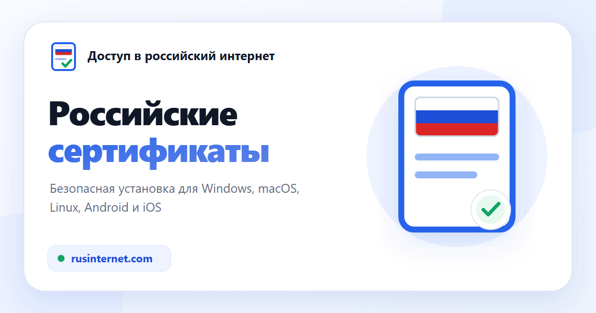

<p align="center">
  <a href="https://rusinternet.com"></a>
</p>

<p align="center"><b>Русский</b> · <a href="README.en.md">English</a></p>

# Доступ в российский интернет

**Открытый помощник по безопасной установке официальных российских доверенных сертификатов (НУЦ Минцифры России).**

**Сайт: [rusinternet.com](https://rusinternet.com)** · RU / EN · Windows, macOS, Linux, iOS/iPadOS, Android

Помогает, когда браузер показывает ошибку сертификата — «Ваше подключение не защищено», `ERR_CERT_AUTHORITY_INVALID`, «Сертификат не является доверенным» — на Госуслугах, в онлайн-банках, на маркетплейсах, в соцсетях и на новостных сайтах.

---

## Зачем это нужно

С 2022 года зарубежные центры сертификации (GlobalSign, DigiCert, Sectigo и другие) перестали обслуживать и начали отзывать TLS-сертификаты российских организаций. Многие сайты перешли на цепочку **НУЦ Минцифры России** (*Russian Trusted Root CA* / *Russian Trusted Sub CA*). Большинство браузеров (Chrome, Edge, Opera, Safari, Firefox) не доверяют этому корню по умолчанию и показывают ошибку, хотя сам сайт работает. Исключение — Яндекс Браузер и Atom: в них корень уже встроен.

Это **ошибка доверия, а не блокировка**. После установки российских корневых сертификатов и перезапуска браузера ошибка пропадает. Сайт **не** обходит блокировки, **не** меняет DNS, **не** добавляет ГОСТ-шифрование в обычный браузер и **не** является VPN.

## Каким сайтам помогает

Госуслуги и госпорталы · онлайн-банки (Сбербанк, ВТБ, Альфа-Банк, ПСБ, РСХБ и др.) · маркетплейсы (Ozon, Wildberries) · соцсети (ВКонтакте, Одноклассники) · новостные сайты и другие ресурсы на сертификатах Минцифры.

Устанавливается **один раз в систему** — и работает во всех браузерах, которые используют системное хранилище (Chrome, Edge, Opera, Vivaldi, Brave, Safari, а также Firefox 120+ на Windows, macOS и Android). В Linux у Firefox собственное хранилище — для него нужен ручной импорт (описан на сайте).

## Возможности

- **Автоопределение ОС** и один понятный сценарий установки для каждой платформы.
- **Прозрачные установщики** с открытым исходным кодом: `install-windows.cmd`, `install-macos.sh`, `install-linux.sh`, профиль iOS (`.mobileconfig`) и честный гайд для Android.
- **Проверка SHA-256 до любых системных изменений** — установка прерывается при любом несовпадении.
- Русская и английская версии главной и всех инструкций с `hreflang` (русская — `x-default`), SEO-разметка (JSON-LD `WebSite` + `FAQPage`), sitemap с языковыми альтернативами, `robots.txt`, `security.txt`, страница 404.
- Подробный FAQ, собранный по реальным вопросам пользователей.

## Модель доверия и безопасность

Распространяется ровно **пять** заранее известных файлов: **два корневых** и **три промежуточных**. Идентичность каждого зафиксирована по **SHA-256** в [`public/downloads/manifest.json`](public/downloads/manifest.json); хэши установщиков — в `src/lib/release.ts` и проверяются тестами.

- Установщики принимают только эти пять файлов и сверяют их SHA-256 **до** изменения системного хранилища.
- Windows: раздельные хранилища Root/CA, UAC, абсолютные пути системных утилит.
- macOS: `trustRoot` назначается только корням; ГОСТ — best-effort (macOS его не поддерживает).
- Linux: в trust anchors добавляются только два корня; промежуточные не повышаются до корней.
- iOS: профиль с системным подтверждением доверия; Android: только ручная установка (silent-установка CA системой запрещена).

Набор **сверен с официальной публикацией Госуслуг (gu-st.ru) 28 августа 2026 года** и распространяется без изменений. Набор **периодически обновляется** в проекте по мере выпуска новых сертификатов.

### Набор сертификатов

| Сертификат | Тип | Действует до |
|---|---|---|
| Russian Trusted Root CA (RSA) | корневой | 2032-02-28 |
| Минцифры России НУЦ корневой (ГОСТ 2025) | корневой | 2040-05-24 |
| Russian Trusted Sub CA (RSA 2022) | промежуточный | 2027-03-06 |
| Russian Trusted Sub CA (RSA 2024) | промежуточный | 2029-07-19 |
| Минцифры России НУЦ подчиненный (ГОСТ 2025) | промежуточный | 2030-05-27 |

Корневые сертификаты действуют **долгий срок** (до 2032 и 2040 годов).

## Совместимость установщиков

- **Windows** — Windows 8.1/10/11 (x86/x64/ARM64); Windows 7 — только с обновлениями, которые включают TLS 1.2 для .NET (иначе загрузка с сайта не пройдёт). Загрузка через `WebClient` с принудительным TLS 1.2, проверка прав через `net session`/`fltMC`, повышение прав работает и при пробелах и скобках в пути к файлу.
- **Linux** — работает на большинстве дистрибутивов (Debian/Ubuntu, Fedora/RHEL, Arch, openSUSE и производных): хранилище выбирается по фактическому каталогу anchors; конвертация DER→PEM без зависимости от `openssl` (через `base64`, есть и в busybox); опциональное добавление в NSS-хранилище Chromium. Firefox использует своё хранилище — нужен ручной импорт.
- **macOS** — Intel и Apple Silicon; RSA-цепочка ставится всегда, ГОСТ пропускается без обрыва.
- **iOS/iPadOS** — профиль из пяти сертификатов + включение полного доверия в настройках.
- **Android** — честный ручной гайд с путями для чистого Android/Pixel, Samsung (One UI) и Xiaomi (HyperOS/MIUI). Отдельное приложение **не** сделает установку проще: без root ни одно приложение не может добавить системный CA, а неподписанный APK вызывает больше предупреждений защиты, чем ручная установка.

## Локальная разработка

```bash
npm ci
npm test        # платформы, сертификаты, установщики, manifest, деплой
npm run dev      # http://localhost:4321
npm run build    # astro check + сборка + проверка CSP → dist/
```

Технологии: [Astro](https://astro.build) (статическая генерация), TypeScript, [Vitest](https://vitest.dev), [astro-icon](https://github.com/natemoo-re/astro-icon).

## Публикация

Сайт работает на собственном сервере (VDS, Docker) и обновляется из ветки `main`: workflow [`.github/workflows/deploy.yml`](.github/workflows/deploy.yml) прогоняет тесты, собирает статику и заливает `dist/` по SSH в новый каталог релиза, а затем переключает на него симлинк `current` — атомарно, без простоя. Сборка на сервере не идёт: он только раздаёт файлы.

Ключ деплоя лежит в секрете окружения `production` (доступно только ветке `main`) и на сервере ограничен принудительной командой [`deploy/server/rusinternet-deploy.sh`](deploy/server/rusinternet-deploy.sh): разрешены только запись нового релиза через `rrsync -wo` и его активация. Ключ хоста закреплён в workflow.

На сервере 80/443 слушает один общий Caddy ([`deploy/server/edge`](deploy/server/edge)): он выпускает сертификаты Let's Encrypt, перенаправляет HTTP и `www` на `https://rusinternet.com` и маршрутизирует по имени хоста, так что другие проекты сервера добавляются отдельным файлом в `sites/`. Установщики и контрольные суммы раздаются только по HTTPS.

После деплоя workflow проверяет живой сайт (`scripts/smoke-production.mjs`): все страницы из sitemap отвечают 200, неизвестный путь — 404, а установщики и сертификаты совпадают по SHA-256 с `manifest.json`. Затем список страниц уходит в IndexNow (`scripts/indexnow.mjs`): его используют Яндекс и Bing. Раз в неделю workflow [`upstream-certificates.yml`](.github/workflows/upstream-certificates.yml) сверяет набор с архивами Госуслуг и открывает issue при расхождении — сам он ничего не публикует. Тоже раз в неделю [`tls-certificate.yml`](.github/workflows/tls-certificate.yml) проверяет TLS-сертификаты `rusinternet.com` и `www`: Caddy продлевает их примерно за 30 дней до окончания, и если осталось меньше 21 дня или цепочка не проходит проверку, открывается issue.

Строгая CSP действует через `<meta http-equiv="Content-Security-Policy">`: исполняемые скрипты и стили вынесены в same-origin-файлы, а JSON-LD разрешён только по точным SHA-256-хэшам. Сборка автоматически проверяет все HTML-страницы (сейчас 15) и падает при появлении inline-кода, `unsafe-inline`, `unsafe-eval` или отсутствующего хэша.

Caddy добавляет то, чего не умеет meta-CSP: HSTS, `X-Content-Type-Options`, `Referrer-Policy`, `Permissions-Policy` и `Content-Security-Policy: frame-ancestors 'none'`. Профиль iOS отдаётся как `application/x-apple-aspen-config`, установщики — как `text/plain`.

## Структура проекта

```
public/downloads/     сертификаты (.cer), установщики, iOS-профиль, manifest.json
src/components/        HomePage.astro — главная, GuidePage.astro — инструкция (RU/EN)
src/layouts/           BaseLayout.astro — общий каркас, темы, футер
src/pages/             index, install/[platform] (RU); en/index, en/install/[platform] (EN); 404
scripts/               проверка CSP сборки, smoke-тест продакшена, IndexNow, сверка с Госуслугами
src/lib/               platform, release (хэши), manifest, certificate-plan, os-icons
tests/                 автоматические проверки
docs/                  ROADMAP, заметки по безопасности
```

## Внести вклад

Проект открытый — файлы, скрипты и контрольные суммы можно проверить прямо здесь. Нашли ошибку или хотите предложить улучшение — открывайте issue или pull request. Вопросы безопасности: [`/.well-known/security.txt`](public/.well-known/security.txt) или почта ниже.

## Дисклеймер

Независимый некоммерческий проект. **Не связан** с Госуслугами, Минцифры России, госорганами или банками и не является их официальным ресурсом. Инструменты предоставляются «как есть», без гарантий; установка меняет доверенные корневые сертификаты системы — выполняйте её по своему усмотрению, удалить их можно в любой момент. Сайт не собирает персональные данные, не использует аналитику и куки.

## Лицензия

Код проекта распространяется по лицензии [MIT](LICENSE). Сертификаты в `public/downloads/certificates/` — официальные файлы Минцифры России, распространяются без изменений и под эту лицензию не подпадают.

## Контакты

[wyrtensi@gmail.com](mailto:wyrtensi@gmail.com)
